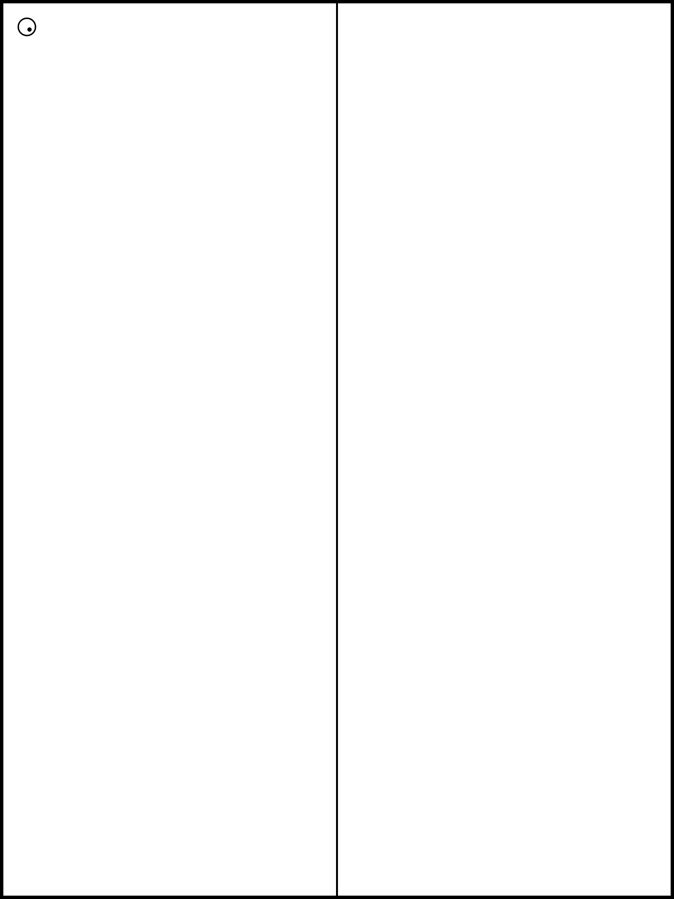
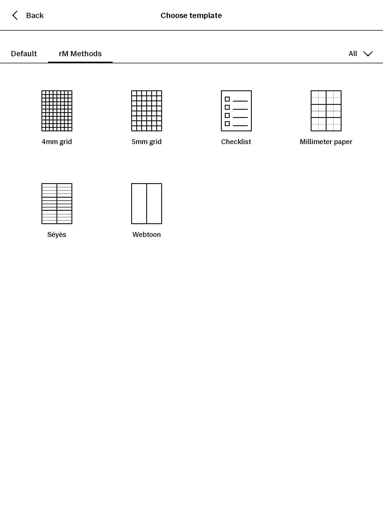

# Kalamart's reMarkable templates


This repository contains a few templates that I created for my personal use on the [reMarkable tablet](https://remarkable.com/). All of them are free to use and modify for non-commercial use.

These templates are made with the new ["rm methods"](https://spacepanda.se/articles/rm_methods.html) standard, which means they are generated "on the go" from a JSON description. That makes them much more flexible than PDF templates. They are compatible with the infinite scroll feature, and can be set page-by-page on any notebook, same as any other template. They also remain installed even after a software update.

> [!TIP]
> Most templates have both a portrait and a landscape version. I recommend installing both, since using a portrait template in landscape mode (or vice versa) can lead to the whole thing being stretched/squished.

> [!WARNING]
> - These custom templates aren't rendered when looking at the pages on the reMarkable cloud (web app, desktop app, smartphone app), since the template definition only exists locally on your device. You can however see them with screen share, as well as after a PDF or PNG export from the device.
> - I tried to make them compatible with different screen sizes, but I can only test on my reMarkable 2, so I cannot guarantee that the measurements will all be accurate on other models, especially if they have a different DPI.
> - The "rm methods" feature is only available for reMarkable software versions 3.17 and above.

## Available templates

**<details><summary>5mm grid</summary>**
A simple grid with 5mm spacing.


</details>

**<details><summary>4mm grid</summary>**
A simple grid with 4mm spacing.


</details>

**<details><summary>Checklist</summary>**
A compact checklist template with checkboxes and lines for writing. The lines are spaced by 8mm, and the checkboxes are 4mm in size.


</details>

**<details><summary>Millimeter paper</summary>**
Standard graph paper with 1mm spacing, and darker lines every 5mm and 1cm. The lines are orange.


</details>

**<details><summary>Séyès</summary>**
This is a very popular French ruling system used for handwriting, with lines spaced by 8mm and additional horizontal lines every 2mm for letter height. The lines are dark blue and light blue, and there is a red vertical margin line on the left side of the page.


</details>

**<details><summary>Webtoon</summary>**
This is a personal template I use for sketching my scrollable comics. It simply splits the page into 2 columns, which gives me a more manageable constant page width. This template is only available in portrait orientation.


</details>
  
## Installation

In order to install those templates, you need to connect to your reMarkable device via SSH. You can find instructions on how to do that [here](https://remarkable.guide/guide/access/ssh.html).

The template files should be copied to the `/home/root/.local/share/remarkable/xochitl` directory on the device (yes, thrown in the middle of the notebooks and other templates, without any dedicated subdirectory per template). The necessary files are the `.content`, `.metadata` and `.template` files.

**<details><summary>Using `sftp` (works with most file explorers but not all)</summary>**
`sftp` is a tool that uses the SSH protocol to transfer files. The advantage is that it allows you to navigate through the reMarkable's file system and copy files more easily, using the familiar graphical interface of your file explorer.

Simply enter `sftp://root@IP_ADDRESS/home/root/.local/share/remarkable/xochitl` in your file explorer (replace `IP_ADDRESS` with the actual IP address of your reMarkable device), and you should be able to drag and drop the template files from your computer to the reMarkable.
</details>

**<details><summary>Using `scp` (via command line)</summary>**
`scp` is a command-line tool to copy files from your computer to the reMarkable using the SSH protocol.

**Example:**
```bash
cd checklist
scp -r * root@IP_ADDRESS:/home/root/.local/share/remarkable/xochitl
```
(Replace `IP_ADDRESS` with the actual IP address of your reMarkable device.)
</details>

</br>

Once you copied all of the templates you want, restart your reMarkable device. You should now see the new templates in the "rM Methods" tab of the template picker.

